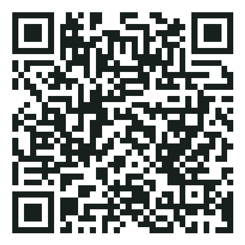

# 클린오피스 (Clean Office)

**광고 없는 문서 뷰어·편집기.** PDF·워드·엑셀·파워포인트·한글(HWP/HWPX) 파일을 열고, 간단히 고쳐서 저장합니다.
안드로이드 앱과 PC(브라우저) 둘 다 쓸 수 있고, 같은 와이파이에서는 PC와 휴대폰이 파일을 주고받을 수 있습니다.

- 광고·추적·로그인 없음
- 문서는 기기 밖(외부 서버)으로 나가지 않음
- 무료, 오픈소스(MIT)

> An ad-free document viewer/editor for Android and desktop browsers (PDF, DOCX, XLSX, PPTX, HWP/HWPX), with Wi-Fi file sharing between PC and phone via QR code.

## 할 수 있는 것

| 형식 | 보기 | 편집 | 저장 |
|---|---|---|---|
| PDF | ✅ 확대/축소 | – | 원본 |
| 워드 DOCX | ✅ 원본 서식 | ✅ 글·표·그림·목록·글자색 | DOCX · PDF · TXT |
| 엑셀 XLSX · XLS · CSV | ✅ | ✅ 값·수식(SUM, AVERAGE, IF 등)·시트 추가 | XLSX · CSV · PDF |
| 파워포인트 PPTX | ✅ | ✅ 슬라이드 글자 고치기·순서 바꾸기·삭제 (디자인은 그대로) | PPTX |
| 한글 HWP · HWPX | ✅ | ✅ 한글처럼 편집 (메뉴·툴바·표, [rhwp-studio](https://github.com/edwardkim/rhwp) 내장) | HWP · HWPX |
| 옛 워드 DOC · 옛 파워포인트 PPT | ✅ 글자만 | DOCX·PPTX로 바꿔서 편집 | DOCX · PPTX |
| TXT · 이미지 | ✅ | TXT → 문서 편집 | DOCX 등 |

아직 안 되는 것: 옛 DOC/PPT의 서식·그림, 파워포인트 도형·그림 편집, 워드 편집 시 복잡한 레이아웃(머리말·다단) 유지.
휴대폰에서 한글 편집기는 PC용 화면이라 메뉴가 작게 보입니다.

## 설치·사용

### 안드로이드

<p></p>

휴대폰 카메라로 위 QR을 찍으면 **최신 APK가 바로 내려받아집니다**
(주소: `https://github.com/CapyKkuing/clean-office/releases/latest/download/CleanOffice.apk`).

1. QR을 찍거나 [Releases](../../releases)에서 APK를 내려받습니다.
2. 설치할 때 "출처를 알 수 없는 앱 설치"를 허용합니다.
3. **파일 열기**를 누르면 폰의 기본 파일 선택창이 뜹니다. 구글 드라이브·원드라이브·드롭박스 등 폰에 설치된 클라우드 앱도 이 창에 나오므로, 거기서 열고 같은 파일에 그대로 저장할 수 있습니다.
4. 카카오톡·파일 앱 등에서 문서를 누르고 "클린오피스로 열기"를 골라도 됩니다.

### PC (윈도우)
1. [Node.js](https://nodejs.org) LTS를 설치합니다.
2. 이 저장소를 내려받아(Code → Download ZIP) 압축을 풉니다.
3. `클린오피스 실행.bat`을 더블클릭합니다. 처음엔 준비에 몇 분 걸리고, 브라우저에 클린오피스가 열립니다(`http://localhost:5192`).
4. 크롬·엣지에서는 연 파일에 바로 덮어써서 저장됩니다.

### PC ↔ 휴대폰 파일 주고받기 (같은 와이파이)
1. PC 화면에서 **폰 연결**을 누르면 QR 코드가 나옵니다.
2. 폰 앱에서 **PC 연결 → QR 코드 찍기**.
3. PC의 `문서\클린오피스` 폴더 파일을 폰에서 열고 저장할 수 있고, 폰 문서를 **PC로 보내기**할 수 있습니다.

- 처음 켤 때 윈도우 방화벽 창이 뜨면 **개인 네트워크** 허용을 눌러 주세요.
- 연결 코드는 비밀번호와 같습니다. 남에게 보여주지 마세요. PC 화면에서 언제든 새 코드로 바꿀 수 있습니다.
- 통신은 집·사무실 와이파이 안에서만 오가는 http입니다. 카페 같은 공용 와이파이에서는 쓰지 마세요.

## 개발

```
npm install
npm run hwp-studio     # 한글 편집기(rhwp-studio)를 소스에서 빌드해 public/hwp-studio 에 넣음 (처음 1번, git 필요)
npm run dev            # 개발 서버 (http://localhost:5173)
npm run build          # 웹 빌드 (dist)
npm start              # PC 서버 (dist + 폰 연결)
npm run android        # 빌드 후 안드로이드 프로젝트에 반영
cd android && gradlew assembleRelease   # APK (JDK 21, Android SDK 필요)
```

구조
- `src/` 화면(웹앱). 같은 코드를 PC 브라우저와 안드로이드 앱(Capacitor)이 함께 씀
- `src/files.js` 기기별 열기·저장 (안드로이드 파일 선택창 / 크롬·엣지 파일 핸들 / 다운로드)
- `src/pc-link.js` PC↔폰 연결 화면, `server/server.mjs` PC 쪽 서버
- `android/.../DocFilesPlugin.java` 안드로이드 파일 선택창·같은 파일 저장·"클린오피스로 열기"
- `src/pptx-editor.js` PPTX 글자 편집 (슬라이드 XML의 글자만 바꿈), `src/legacy.js` 옛 DOC·PPT 글자 꺼내기
- `src/hwp-editor.js` 한글 편집기 연결, `tools/build-hwp-studio.mjs` 편집기 오프라인 빌드 (외부 웹폰트 끔)

PC 서버 보안: 연결 코드가 없으면 거부, 10번 틀리면 1분 잠금, 공유 폴더 밖 접근·바로가기 차단, QR·코드 정보는 그 PC의 클린오피스 화면에서만 보임(출처·접속주소 검사). 알려진 한계: 통신이 암호화되지 않음(HTTPS는 추후 과제) → 믿을 수 있는 와이파이에서만 사용.

## 라이선스

[MIT](LICENSE). 사용한 오픈소스 부품과 라이선스는 [THIRD_PARTY_NOTICES.md](THIRD_PARTY_NOTICES.md)에 있습니다.
한글 문서 표시는 [rhwp](https://github.com/edwardkim/rhwp)를 사용합니다.

## 변경 기록

- **0.2.1** (2026-10-27) 워드·파워포인트·한글 편집 화면 통일(간단 편집 기본, 필요하면 '상세 편집'), 새 슬라이드·새 한글 문서 만들기, 확대·축소 버튼과 두 손가락 확대, 옛 DOC 여러 종류(RTF·HTML 등) 열기, 앱 종료 확인 창, 깨진 툴바 아이콘 수정.
- **0.2.0** (2026-10-27) 한글(HWP·HWPX) 편집기 내장, 파워포인트 글자 편집, 옛 DOC·PPT 열기·새 형식으로 바꾸기, 화면 디자인 새로 정돈, QR로 APK 바로 받기. APK 크기가 커짐(한글 편집 엔진 포함).

- **0.1.2** (2026-10-27) 외부 보안 검수(2차) 반영: 조작된 파일 이름으로 앱 안에서 코드가 실행될 수 있던 문제 수정. 잘못된 요청 한 번에 PC 서버가 꺼지던 문제 수정. 엑셀 수식의 참조 범위(20만 칸)와 표시 열 수 상한. 공유 폴더 안 바로가기(정션)로 폴더 밖 파일에 닿던 문제 차단. 문서 속 링크 정화(javascript: 링크 제거, 외부 링크는 새 창).

- **0.1.1** (2026-10-27) 보안 점검 반영: PC 서버가 다른 웹사이트·가짜 주소의 요청에 연결 코드를 내주지 않도록 출처·접속주소 검사 추가. 안드로이드 자동 백업 끔(최근 문서·연결 코드가 클라우드 백업에 안 들어감). 공용 와이파이 사용 금지 안내를 앱 화면에 표시.
- **0.1.0** (2026-10-27) 첫 공개.
